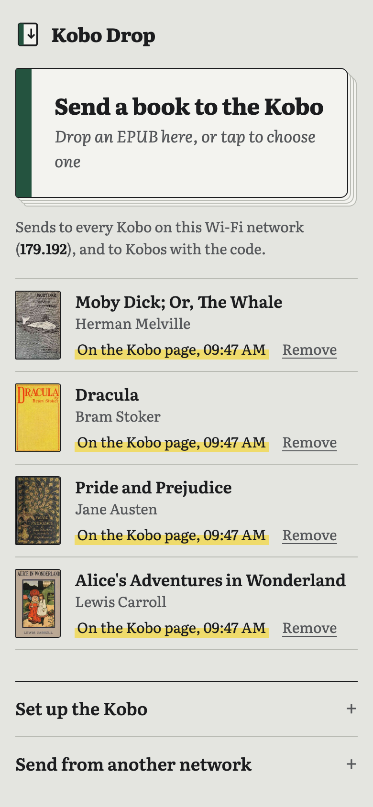
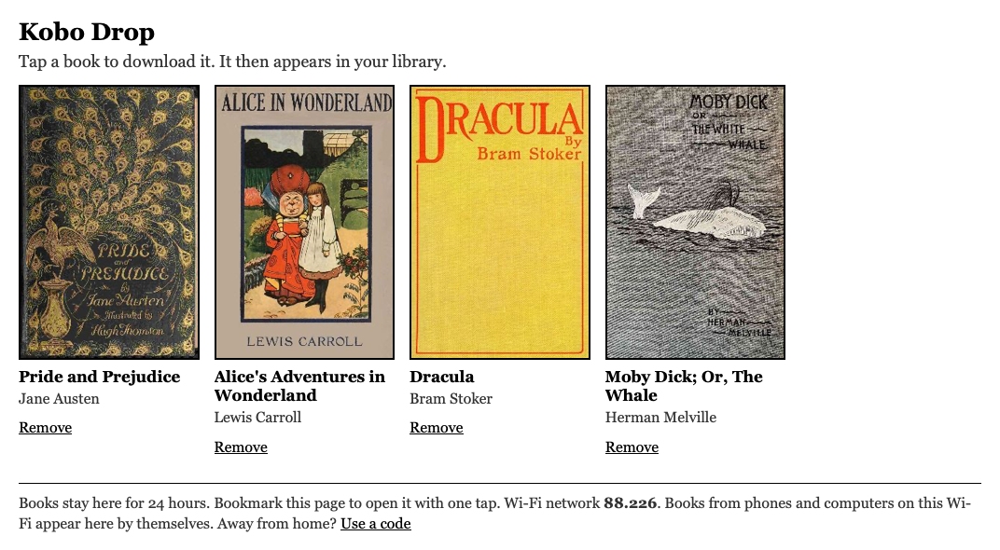

<p align="center">
  
</p>

<h1 align="center">Kobo Drop</h1>

<p align="center">
  Send EPUBs from your phone to your Kobo. They arrive as KEPUB, with a clean title, author and cover.<br>
  No cable, no Calibre, no account.
</p>

<p align="center">
  <a href="https://jeramai.github.io/kobo-drop/"><b>Open Kobo Drop</b></a>
</p>

<table align="center">
  <tr>
    <td align="center"></td>
    <td align="center"></td>
  </tr>
  <tr>
    <td align="center"><sub>On the phone</sub></td>
    <td align="center"><sub>On the Kobo</sub></td>
  </tr>
</table>

## How to use it

1. **On the Kobo**, open *More → Beta features → Web browser* and go to
   `jeramai.github.io/kobo-drop/k/`. Bookmark it.
2. **On your phone or computer**, open [jeramai.github.io/kobo-drop](https://jeramai.github.io/kobo-drop/)
   and drop one or more EPUBs on it.
3. **On the Kobo**, the books appear within seconds. Tap a cover, and it lands in your library.

On the same Wi-Fi that is all. To send from somewhere else, the send page shows an
8-character code that you type once on the Kobo page.

**Install it as an app.** On Android, *Chrome menu → Install app* adds Kobo Drop to the share
sheet, so you can send a book from Files, downloads or email with *Share → Kobo Drop*. On an
iPhone, *Share → Add to Home Screen* gives you a full-screen app.

## Why KEPUB

The Kobo picks its reader by file name. A `.kepub.epub` opens in Kobo's own renderer: faster page
turns, reading statistics, time left in chapter, better fonts and hyphenation. A plain `.epub`
opens in the older Adobe renderer. Kobo Drop runs [kepubify](https://github.com/pgaskin/kepubify)
in your browser, so every book arrives as KEPUB.

## Clean titles and covers

Books from the internet often carry junk such as `z-library.sk, 1lib.sk` or `(z-lib.org)` in their
title. Kobo Drop removes it, writes the clean title and author into the book itself (the Kobo
library reads them from there), and names the file `Author - Title.kepub.epub`. A book without a
cover gets one from [Open Library](https://openlibrary.org), with Google Books as a fallback, and
the cover goes into the book too.

## How it works

```
phone / computer                     Cloudflare Worker                 Kobo browser
────────────────                     ─────────────────                 ────────────
EPUB ─► kepubify (WebAssembly)
        reads title, author, cover
        ─────── 20 MB parts ───────►  KV, kept 24 hours
                                      list per channel   ◄── polls every 8 s ── shelf page
                                      /book/… download   ───────────────────►  tap a cover
```

- **Conversion happens on your device.** The kepubify Go library is compiled to WebAssembly
  (`kepubify.wasm`), so the server never sees an EPUB, only the finished KEPUB.
- **Channels instead of accounts.** Both pages look up their public IPv4 address; devices on the
  same Wi-Fi share it, and so share a channel. The code is a second channel for other networks.
- **The Kobo page is old-school on purpose.** The Kobo browser is an old WebKit without `fetch`,
  `Promise` or WebRTC, so `k/index.html` is plain ES5 with `XMLHttpRequest`, and a fixed
  1072 px layout for the Clara's screen.
- **Large books** go up in 20 MB parts, because a KV value holds at most 25 MB. The Worker
  streams the parts back as one file. The limit is 100 MB per book.

| Path | What it is |
|---|---|
| `index.html`, `app.js`, `style.css` | The send page |
| `k/index.html` | The Kobo page (ES5, inline) |
| `sw.js`, `manifest.webmanifest` | PWA install and the Android share target |
| `worker/` | The Cloudflare Worker and its KV binding |
| `names.js` | Title clean-up and file names |
| `wasm/main.go` | The WebAssembly entry point: kepubify, metadata, and writing title and cover back |

## Privacy

Books stay on the server for 24 hours, then KV deletes them. You can remove a book earlier from
either page. There are no accounts, cookies or analytics; the pages do load Literata from Google
Fonts and ask [ipify](https://www.ipify.org) (or icanhazip.com when ipify fails) for your public address, and for a book without a
cover the Worker sends its title and author to Open Library and Google Books. Anyone who knows your channel (your
public IP address or your code) can see and add books while they are there, so treat the code
like a house key for a mailbox, not a vault.

## Run your own

You need a free Cloudflare account and a GitHub account.

```sh
# 1. The Worker
cd worker
npx wrangler login
npx wrangler kv namespace create BOOKS   # put the id in wrangler.jsonc
npx wrangler deploy                       # note the *.workers.dev URL

# 2. The pages: set that URL as API in app.js and k/index.html,
#    then enable GitHub Pages on the main branch (or host the folder anywhere static).
```

### Rebuild the converter

```sh
git clone https://github.com/pgaskin/kepubify && cd kepubify
mkdir -p cmd/kepubify-wasm && cp ../wasm/main.go cmd/kepubify-wasm/
GOOS=js GOARCH=wasm go build -ldflags="-s -w" -trimpath -o ../kepubify.wasm ./cmd/kepubify-wasm
cp "$(go env GOROOT)/lib/wasm/wasm_exec.js" ..
```

## License

[MIT](LICENSE): free for everybody to use, change and share. The bundled kepubify is MIT too.

## Credits

[kepubify](https://github.com/pgaskin/kepubify) by Patrick Gaskin does the conversion
(MIT, see `LICENSE-kepubify`). Typeset in [Literata](https://fonts.google.com/specimen/Literata).
Kobo is a trademark of Rakuten Kobo Inc.; this project is not affiliated with it.
